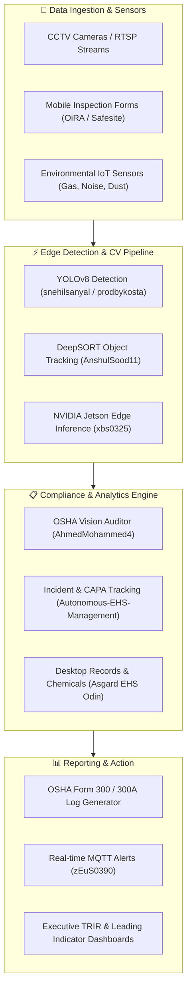

# 🦺 Awesome Workplace Safety & OSHA Audit Analyzers

  <b>A curated catalog of enterprise Environmental Health &amp; Safety (EHS) SaaS platforms, digital OSHA compliance audit analyzers, automated hazard detection systems, and open-source AI computer vision safety tools.</b>

---

[⚡ Sector Overview](#-sector-overview--market-dynamics) •
[🏢 SaaS Platforms](#-saas--hosted-audit-platforms) •
[💻 Open-Source Projects](#-open-source-github-projects) •
[🧩 Architectural Patterns](#-custom-safety-stack-framework) •
[🤝 Contributing](#-how-to-contribute) •
[⭐ Star History](#-star-history) •
[💖 Support](#-support--sponsorship)

---

## 📖 Introduction & SEO Overview

**Workplace Safety (OSHA) Audit Analyzers** empower safety managers, EHS directors, and enterprise risk officers to proactively audit field operations, identify hazardous situations, enforce Personal Protective Equipment (PPE) compliance, and streamline OSHA regulatory recordkeeping (such as **OSHA Form 300, 300A, and 301** incident reporting).

Whether you are seeking an enterprise-wide cloud solution for multi-site audit management or self-hosting open-source computer vision pipelines using **YOLOv8** and edge AI for continuous CCTV surveillance, this guide compiles the leading tools in the industry.

---

## 📊 Sector Overview & Market Dynamics

The global Environmental Health, Safety (EHS) and workplace safety audit software market is currently valued between **$2.5 billion and $3.5 billion**, with analyst consensus projecting a steady compound annual growth rate (**CAGR of 7.5%–11.0%**), surpassing **$5.8 billion to $6.2 billion by 2030**. Growth is driven by stringent worldwide OSHA and EU-OSHA regulatory scrutiny, ESG risk reporting standards, worker compensation insurance incentives, and the rapid deployment of AI-based computer vision on construction sites and factory floors.

The market structure is **moderately-to-highly fragmented** and intensely competitive rather than a winner-take-all monopoly:
- **Enterprise Giants & Conglomerates:** Established players (Wolters Kluwer/Enablon, Fortive/Intelex, Cority, and VelocityEHS) maintain strong holds across Fortune 500 chemical, energy, automotive, and heavy manufacturing sectors with comprehensive EHSQ suites.
- **Mobile-First & Mid-Market Challengers:** Modern solutions like SafetyCulture and Safesite disrupt field operations with agile checklists, rapid onboarding, and transparent pricing.
- **Edge AI & Computer Vision Frontier:** Open-source projects and specialized computer vision startups are filling gaps in automated, real-time PPE detection and unsafe posture tracking, decentralizing safety inspection workflows away from manual paper audits.

---

## 🏢 SaaS & Hosted Audit Platforms

The following table compares leading commercial Workplace Safety, EHS, and OSHA compliance platforms, sorted in descending order by **Company Size (Revenue / Valuation)**:

| 🏢 Platform / Vendor | 📈 Company Size (Revenue / Valuation) | 💵 Starting Tier Price | 🎁 Free Tier / Trial Limit | 🛠️ Core Safety & OSHA Capabilities |
| :--- | :--- | :--- | :--- | :--- |
| **[Enablon](https://www.enablon.com/)** *(Wolters Kluwer)* | **~$42B** Market Cap / **€5.6B+** Annual Revenue | **~$50,000 / year** *(~$4,167/mo base enterprise deployment)* | **0 days** *(No self-serve free tier; custom guided sandbox proof-of-concept upon sales scoping)* | Tier-1 enterprise EHSQ, operational risk management (ORM), incident investigations, OSHA 300/300A log automation, and sustainability compliance. |
| **[Intelex](https://www.intelex.com/)** *(Fortive Corp)* | **~$26B** Market Cap *(Fortive)* / **$220M** Acquisition | **$44 – $49 / user / month** *(Intelex Essentials tier, min. 25 users billed annually at ~$13,200/yr)* | **30-day free trial** *(Interactive evaluation sandbox with full module access on request)* | Comprehensive safety audit checklists, CAPA management, root-cause investigations, and regulatory compliance dashboards. |
| **[Quentic](https://www.quentic.com/)** *(AMCS Group)* | **~$2.5B** Valuation *(AMCS)* / **€180M+** Group ARR | **~€800 / month** *(~$870/mo or €9,600/yr base module package)* | **0 days** *(No public free trial; structured live interactive demo & ROI compliance assessment upon request)* | European & global HSE/EHS management, offline mobile inspections, digital safety walkthroughs, hazardous substance tracking, and legal compliance registers. |
| **[SafetyCulture](https://safetyculture.com/)** *(formerly iAuditor)* | **~$1.8B – $2.5B** Valuation / **$100M+** ARR | **$24 / user / month** *(billed annually) or $29/mo (monthly Premium plan)* | **Free forever plan** *(Up to 10 team members, 5 active inspection templates, basic analytics, and 300 AI credits/user/mo)* | Mobile-first safety inspection app, customizable OSHA compliance checklist templates, automated corrective action assigning, and real-time incident reports. |
| **[Cority](https://www.cority.com/)** *(Thoma Bravo)* | **~$1.0B+** Valuation / **$150M – $250M** ARR | **£11,200 / module / year** *(~$14,500/yr or £20,000/yr base instance on G-Cloud)* | **0 days** *(No self-serve free tier; custom sandbox trial provided during enterprise procurement review)* | Integrated EHSQ and occupational health suite, ergonomics assessments, industrial hygiene tracking, clinical surveillance, and automated safety audit workflows. |
| **[VelocityEHS](https://www.velocityehs.com/)** | **~$420M – $600M** Valuation / **~$130M** ARR | **$5,000 – $10,000 / year** *(~$416 – $833/month base package)* | **14-day free trial** *(Interactive sandbox access following tailored technical scoping demo)* | Accelerate® EHS platform with industrial hygiene monitoring, ergonomic risk scoring, incident reporting, chemical SDS management, and OSHA recordables. |
| **[Origami Risk](https://www.origamirisk.com/)** | **~$400M – $500M** Valuation / **~$100M** ARR | **$500 – $1,000 / month** *(Base configuration, $6,000 – $12,000/year minimum)* | **0 days** *(No self-serve free tier; scoped pilot environment and proof-of-concept for qualified prospects)* | Unified Risk Management Information System (RMIS) and EHS platform for incident claims, OSHA logs, site safety audits, and job safety analysis (JSA). |
| **[KPA Flex](https://www.kpaflex.com/)** *(Novara)* | **~$150M – $250M** Valuation / **~$50M – $100M** ARR | **$50 / user / month** *(or $120/month base subscription package)* | **14-day free trial** *(Guided sandbox evaluation environment available upon sales consultation)* | SMB and mid-market field safety software, mobile inspection forms, safety training tracking, toolbox talks, and digital OSHA 300/300A/301 logs. |
| **[Benchmark ESG](https://www.benchmarkgensuite.com/)** *(Gensuite)* | **~$100M – $150M** Valuation / **~$28.2M** ARR | **$1,500 / month** *($18,000/year entry baseline suite)* | **0 days** *(No self-serve free tier; executive demonstration and structured pilot sandbox on request)* | Digital EHS and sustainability operations management, multi-plant audit protocols, action closure dashboards, and computer vision safety pilots. |
| **[Safesite](https://safesitehq.com/)** *(Foresight)* | **~$30M – $50M** Valuation / **~$10M** ARR | **$16 / member / month** *(Premium plan, billed annually)* | **Free forever plan** *(Unlimited users, unlimited mobile inspections, hazard logging, safety meetings; 30-day reporting history limit)* | Paperless safety inspection app, pre-built OSHA checklists, hazard resolution workflows, and automated OSHA 300 log exports. |
| **[SALUS](https://salussafety.io/)** | **~$15M – $25M** Valuation / **~$5M** ARR | **$250 / month** *(Base contractor tier, $3,000/year)* | **14-day free trial** *(Full-feature trial environment available upon sales walkthrough request)* | Subcontractor and construction safety management, digital compliance forms, worker certification tracking, and joint jobsite safety audits. |

---

## 💻 Open-Source GitHub Projects

Open-source safety software enables complete data sovereignty, self-hosting on local servers, integration with edge computing devices (like NVIDIA Jetson), and customization for specialized worksite hazards.

Repositories are listed in descending order by **GitHub Stars_Count**:

### 1. [Checkmarx/kics](https://github.com/Checkmarx/kics) 
- **Primary Focus:** Static Compliance & Security Auditing for Infrastructure as Code (IaC)
- **Key Features:** Automated scanning for misconfigurations, regulatory compliance checks across Terraform, Kubernetes, Docker, and CloudFormation. Adaptable for automated workplace safety compliance rules in IoT and physical facility control architectures.
- **Tech Stack:** Go • Apache-2.0 License

### 2. [snehilsanyal/Construction-Site-Safety-PPE-Detection](https://github.com/snehilsanyal/Construction-Site-Safety-PPE-Detection) 
- **Primary Focus:** Construction Site PPE Detection
- **Key Features:** Deep learning computer vision pipeline utilizing YOLOv8 to verify whether personnel are properly equipped with hard hats, high-visibility vests, boots, and safety gloves.
- **Tech Stack:** Python • YOLOv8 • PyTorch • Jupyter Notebook

### 3. [AnshulSood11/PPE-Detection-YOLO-Deep_SORT](https://github.com/AnshulSood11/PPE-Detection-YOLO-Deep_SORT) 
- **Primary Focus:** Real-Time PPE Detection with Multi-Worker Tracking
- **Key Features:** Combines YOLO object detection with DeepSORT tracking algorithms to continuously trace individual workers across CCTV frames and audit PPE non-compliance without double-counting violations.
- **Tech Stack:** Python • OpenCV • YOLO • DeepSORT

### 4. [ZijianWang-ZW/PPE_detection](https://github.com/ZijianWang-ZW/PPE_detection) 
- **Primary Focus:** Industrial PPE Detection & Open Benchmark Dataset
- **Key Features:** Production-grade YOLO detection pipeline coupled with high-quality annotated training datasets for industrial safety inspections and gear compliance auditing.
- **Tech Stack:** Python • YOLO • PyTorch

### 5. [Ismailjm/PPE_detection_using_YOLOV8](https://github.com/Ismailjm/PPE_detection_using_YOLOV8) 
- **Primary Focus:** Real-Time Worksite Safety Verification
- **Key Features:** Leverages YOLOv8 models to identify required safety apparel (helmets, vests, safety glasses) in hazardous industrial operational zones with instant visual violation bounding boxes.
- **Tech Stack:** Python • YOLOv8 • Ultralytics

### 6. [prodbykosta/ppe-safety-detection-ai](https://github.com/prodbykosta/ppe-safety-detection-ai) 
- **Primary Focus:** Edge Computer Vision for Workplace Safety Auditing
- **Key Features:** Detects human workers and monitors PPE compliance in real time using YOLO with tracking mechanisms and automated annotated MP4 video output for audit logs.
- **Tech Stack:** Python • OpenCV • Ultralytics YOLO

### 7. [balakreshnan/WorkplaceSafety](https://github.com/balakreshnan/WorkplaceSafety) 
- **Primary Focus:** Cloud & Edge Custom Vision Safety Monitoring
- **Key Features:** AI-based workplace safety monitoring system designed for perimeter intrusion detection, restricted hazardous zone infractions, and safety protocol enforcement.
- **Tech Stack:** Python • Azure Custom Vision • OpenCV

### 8. [VoxDroid/Construction-Site-Safety-PPE-Detection](https://github.com/VoxDroid/Construction-Site-Safety-PPE-Detection) 
- **Primary Focus:** End-to-End Safety Detection Dashboard
- **Key Features:** Comprehensive YOLOv8 pipeline featuring training notebooks, pretrained Roboflow weights, live inference scripts, and a Flask web dashboard for real-time compliance reporting.
- **Tech Stack:** Python • Flask • YOLOv8 • Roboflow

### 9. [zEuS0390/ppe-detection-for-construction-site-safety](https://github.com/zEuS0390/ppe-detection-for-construction-site-safety) 
- **Primary Focus:** IoT-Enabled PPE Monitoring & Push Alerts
- **Key Features:** Cloud-based safety monitoring application delivering instantaneous violation alerts to safety officers' mobile devices via lightweight MQTT messaging protocol.
- **Tech Stack:** Python • MQTT • Computer Vision • Cloud Backend

### 10. [swadhinbiswas/AegisVision](https://github.com/swadhinbiswas/AegisVision) 
- **Primary Focus:** Multi-Camera Behavioral Monitoring & Surveillance
- **Key Features:** Plug-and-play AI surveillance platform with occupancy tracking, anti-theft memory, unsafe posture recognition, and a Generative-AI copilot for natural language video queries.
- **Tech Stack:** FastAPI • React • ChromaDB • Elasticsearch • GPL-3.0 License

### 11. [SafetyMP/Autonomous-EHS-Management](https://github.com/SafetyMP/Autonomous-EHS-Management) 
- **Primary Focus:** Self-Hosted Incident & Corrective Action Console
- **Key Features:** Self-hosted EHS management console supporting incident logging, CAPA verification, audit trails, and Total Recordable Incident Rate (TRIR) metrics with Docker Compose.
- **Tech Stack:** PostgreSQL • Docker • Python

### 12. [darshan1654/AI-PPE-Detection](https://github.com/darshan1654/AI-PPE-Detection) 
- **Primary Focus:** Industrial CCTV Surveillance & Anomaly Detection
- **Key Features:** Real-time CCTV analysis for helmets, masks, and safety vests, paired with anomaly detection for unauthorized area entries. Tested in industrial CNC manufacturing environments.
- **Tech Stack:** Python • Streamlit • OpenCV • YOLO

### 13. [rh-ai-quickstart/multimodal-compliance-monitor](https://github.com/rh-ai-quickstart/multimodal-compliance-monitor) 
- **Primary Focus:** Multimodal Safety Compliance & Operational Chatbot
- **Key Features:** Real-time safety monitoring using YOLO for object detection and BoxMOT for tracking, paired with an LLM conversational assistant to query site violation history.
- **Tech Stack:** Python • BoxMOT • YOLO • Kubernetes / Helm

### 14. [asgardehs/odin](https://github.com/asgardehs/odin) 
- **Primary Focus:** Local-First EHS Compliance Desktop Application
- **Key Features:** Standalone, single-binary Go application built by veteran EHS professionals for incident recordkeeping, chemical inventories, and safety training tracking without external cloud dependencies.
- **Tech Stack:** Go • SQLite • Local-First • GPL-3.0 License

### 15. [xbs0325/industrial-inspection](https://github.com/xbs0325/industrial-inspection) 
- **Primary Focus:** Edge AI Industrial Inspection for NVIDIA Jetson
- **Key Features:** Seeed Studio reference demo combining YOLO for PPE checks with Vision-Language Models (VLM) for complex hazard behaviors (smoking, phone usage, falls) over WebRTC streams.
- **Tech Stack:** Docker • NVIDIA Jetson • YOLO • WebRTC

### 16. [AhmedMohammed4/osha-vision-auditor](https://github.com/AhmedMohammed4/osha-vision-auditor) 
- **Primary Focus:** Video-Based OSHA Compliance Inspector
- **Key Features:** Upload construction footage to automatically detect missing hard hats and safety vests. Generates automated safety risk scores (0–100) and AI audit summaries with clickable violation timestamps.
- **Tech Stack:** Python 3.11 • YOLOv8 • Next.js • Supabase

### 17. [chidubemOkafor/SafeSight.AI](https://github.com/chidubemOkafor/SafeSight.AI) 
- **Primary Focus:** Industrial Safety Video Auditing & LLM Assistant
- **Key Features:** Automated YOLO-based PPE detector with evidence frame extraction and natural language question answering powered by Hugging Face models.
- **Tech Stack:** FastAPI • Next.js 15 • Docker Compose • HuggingFace

### 18. [EU-OSHA/oira.application.buildout](https://github.com/EU-OSHA/oira.application.buildout) 
- **Primary Focus:** Online Interactive Risk Assessment (OiRA) Platform
- **Key Features:** Official open-source risk assessment platform by the European Agency for Safety and Health at Work (EU-OSHA) for small and medium-sized enterprises.
- **Tech Stack:** Python • Plone CMS • Zope

---

## 🧩 Custom Safety Stack Framework

For engineering teams constructing a private, self-hosted workplace safety auditing platform, the recommended architecture combines:

---

## ❓ Frequently Asked Questions (FAQ)

### What makes software OSHA compliant?
OSHA does not "certify" software. Rather, software is considered compliant when it adheres to standard OSHA recordkeeping rules (such as 29 CFR Part 1904), including accurate generation of OSHA 300, 300A, and 301 forms, preserving data integrity, and recording injuries/illnesses within required reporting windows.

### Can computer vision replace safety audit officers?
No. Computer vision serves as an automated leading-indicator sensor that flags hazards (e.g., missing PPE, blocked fire exits, exclusion zone breaches). Human safety officers must verify infractions, determine root causes, and conduct formal audits.

### How should worker privacy be handled when using AI video monitoring?
Workplace safety vision systems should prioritize edge processing, face blurring/anonymization, avoidance of biometric identification unless legally mandated, and transparent communication with worker safety committees.

---

## 🤝 How to Contribute

Contributions are welcome from developers, safety researchers, and EHS practitioners!

1. 🍴 **Fork the repository** on GitHub.
2. 🌿 **Create a feature branch** (`git checkout -b feature/new-safety-tool`).
3. 📝 **Add or update an entry** in `README.md` following the standard table or list format. Ensure descriptions remain factual and link to verified sources.
4. 🚀 **Submit a Pull Request** with a brief summary of the software or repository added.

---

## ⭐ Star History

---

## 💖 Support & Sponsorship

Thank you for utilizing and supporting the **Workplace Safety & OSHA Audit Analyzers** resource!

If this curated repository saves you time, helps your company improve safety standards, or aids your open-source research, please consider supporting the project:

- ⭐ **Star this repository** to help others discover it.
- 🍴 **Fork and submit improvements** to keep the list fresh.
- 📢 **Share with your safety & engineering networks**.
- ☕ **Support development & maintenance**: Consider sponsoring via the [GitHub Sponsor Dashboard](https://github.com/sponsors/ishandutta2007).

---

## ⚖️ Disclaimer

- This is a community-curated directory intended for research, benchmarking, and educational purposes. Inclusion does not imply official endorsement by OSHA, EU-OSHA, or any governmental regulatory agency.
- Organizations must consult certified EHS professionals and legal counsel to guarantee compliance with regional occupational health and safety regulations.

---

  Maintained with ❤️ for safety engineers, EHS officers, and open-source contributors worldwide.

